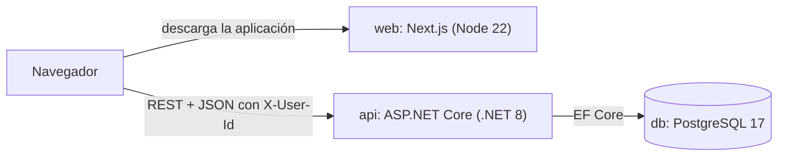
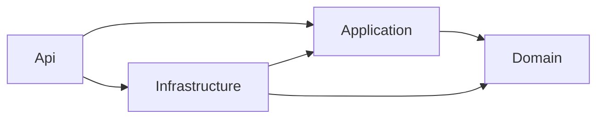

# MaintenanceTracker

Aplicación web para gestionar solicitudes de mantenimiento: registrar una solicitud, asignarle un responsable, llevarla por su ciclo de vida (`Pending → InProgress ⇄ OnHold → Resolved`, o `Cancelled` desde cualquier estado no final) y consultar su historial, que registra cada cambio en la misma transacción que lo produce.

| Parte | Tecnología |
|---|---|
| Backend | .NET 8, ASP.NET Core Web API y EF Core 8, separado en capas (dominio, aplicación, infraestructura y API) |
| Base de datos | PostgreSQL 17 |
| Frontend | Next.js 16 (App Router), React 19, TypeScript, Tailwind CSS 4, TanStack Query y shadcn/ui |

## Requisitos

- **Para ejecutar la aplicación:** Docker con Docker Compose v2. Nada más: la base de datos, la API y el frontend corren en contenedores.
- **Puertos libres:** `3000` (web), `8080` (API) y `5432` (PostgreSQL). Se pueden cambiar en `.env`.
- **Conexión a internet en el primer build:** se descargan las imágenes base, los paquetes de NuGet y npm, y la fuente Inter, que `next/font` incorpora al compilar.
- **Para las pruebas del backend:** SDK de .NET 8. Las de integración además necesitan Docker corriendo.
- **Para desarrollar el frontend fuera de Docker:** Node.js 20.9 o superior (la imagen usa Node 22).

## Ejecutar

```bash
git clone https://github.com/NccJuanP/maintenance-tracker.git
cd maintenance-tracker
cp .env.example .env
docker compose up -d --build
```

`cp` funciona en Bash y en PowerShell; en CMD usa `copy .env.example .env`. El primer build tarda unos minutos.

| Servicio | URL |
|---|---|
| Aplicación web | http://localhost:3000 |
| API | http://localhost:8080 |
| Swagger | http://localhost:8080/swagger |

Al arrancar, la API aplica las migraciones y siembra los usuarios de prueba. No hace falta ningún paso manual: la base empieza sin solicitudes, y se pueden crear desde la aplicación web o desde Swagger.

Para detener todo, `docker compose down` conserva los datos y `docker compose down -v` borra también el volumen de la base.

### Usuario actual (sin autenticación)

No hay autenticación; es una simplificación permitida por el enunciado. Las escrituras (`POST`) identifican a quien hace el cambio con el encabezado `X-User-Id`, que debe ser uno de estos usuarios de prueba:

| Id | Nombre |
|---|---|
| `0b6a2f4e-1c3d-4e5f-8a9b-1d2e3f4a5b01` | Ana Restrepo |
| `0b6a2f4e-1c3d-4e5f-8a9b-1d2e3f4a5b02` | Laura Gómez |
| `0b6a2f4e-1c3d-4e5f-8a9b-1d2e3f4a5b03` | Carlos Mejía |
| `0b6a2f4e-1c3d-4e5f-8a9b-1d2e3f4a5b04` | Andrés Ríos |
| `0b6a2f4e-1c3d-4e5f-8a9b-1d2e3f4a5b05` | Sofía Vélez |

En la aplicación web, el usuario se elige en el selector "Usuario actual" del encabezado. Se guarda en el navegador y se envía como `X-User-Id` en cada creación, asignación y cambio de estado, así que el historial registra el nombre de quien esté seleccionado.

### Ejemplo con curl

```bash
curl -X POST http://localhost:8080/api/maintenance-requests \
  -H "Content-Type: application/json" \
  -H "X-User-Id: 0b6a2f4e-1c3d-4e5f-8a9b-1d2e3f4a5b01" \
  -d '{"title":"Fuga en el piso 3","description":"El lavamanos gotea desde ayer.","category":"Infrastructure","priority":"Medium"}'
```

En Windows, curl no envía en UTF-8 los caracteres no ASCII que van como argumento (tildes, ñ). Si el cuerpo los tiene, guárdalo en un archivo y envíalo con `--data-binary @archivo.json`, o usa Swagger.

## Desarrollo del frontend

Para trabajar en el frontend con recarga en caliente, levanta solo la base y la API en Docker y ejecuta Next.js localmente:

```bash
docker compose up -d db api
cd web
cp .env.example .env.local
npm ci
npm run dev
```

La aplicación queda en http://localhost:3000. Si el contenedor `web` estaba corriendo, detenlo antes con `docker compose stop web`, porque usa el mismo puerto.

`web/.env.local` define `NEXT_PUBLIC_API_URL`, que apunta a la API de Docker (`http://localhost:8080`). Si ejecutas la API con `dotnet run`, usa el puerto que muestre la consola.

## Pruebas

### Backend

Requieren el SDK de .NET 8. Las de integración además necesitan Docker corriendo, porque levantan un PostgreSQL real con Testcontainers.

```bash
dotnet test tests/MaintenanceTracker.Domain.Tests            # reglas de negocio, sin base de datos
dotnet test tests/MaintenanceTracker.Api.IntegrationTests    # API completa contra PostgreSQL
```

### Frontend

El frontend no tiene pruebas automatizadas (ver [Limitaciones](#limitaciones-conocidas)). Se verifica con:

```bash
cd web
npx tsc --noEmit   # tipos
npm run lint       # reglas de ESLint de Next.js
npm run build      # compilación de producción
```

## Endpoints

| Método y ruta | Descripción |
|---|---|
| `GET /api/users` | Catálogo de usuarios |
| `POST /api/maintenance-requests` | Crear solicitud (201 con `Location`) |
| `GET /api/maintenance-requests` | Listado paginado con filtros (`status`, `priority`, `category`, `search`, `sortDirection`, `page`, `pageSize`) |
| `GET /api/maintenance-requests/{id}` | Detalle, con `allowedTransitions` y `canChangeAssignee` |
| `POST /api/maintenance-requests/{id}/assignments` | Asignar o reasignar responsable |
| `POST /api/maintenance-requests/{id}/status-changes` | Cambiar estado |
| `GET /api/maintenance-requests/{id}/activity` | Historial paginado |
| `GET /api/maintenance-requests/summary` | Conteo por estado |

Los errores siguen ProblemDetails (RFC 9457) e incluyen un `code` estable (`validation_failed`, `invalid_status_transition`, `concurrency_conflict`, etc.) y un `traceId`. El contrato completo, con tipos y ejemplos, está en [`docs/domain/event-storming.md`](docs/domain/event-storming.md) (sección 5).

## Migraciones

Para ejecutar la aplicación o las pruebas no hace falta instalar nada: las migraciones se aplican al arrancar. Solo para **crear** una migración nueva se necesita la herramienta `dotnet-ef`, fijada en el manifiesto local:

```bash
dotnet tool restore
ConnectionStrings__Default="Host=localhost" dotnet ef migrations add <Nombre> \
  -p src/MaintenanceTracker.Infrastructure -s src/MaintenanceTracker.Api -o Persistence/Migrations
```

La cadena de conexión es ficticia: la API exige una al arrancar, pero crear la migración no se conecta a la base.

## Configuración

Variables del archivo `.env` de la raíz:

| Variable | Uso | Por defecto |
|---|---|---|
| `POSTGRES_USER`, `POSTGRES_PASSWORD`, `POSTGRES_DB` | Credenciales de la base (solo desarrollo) | ver `.env.example` |
| `POSTGRES_PORT` | Puerto de PostgreSQL en el host | `5432` |
| `API_PORT` | Puerto de la API en el host | `8080` |
| `DATABASE_APPLY_MIGRATIONS_ON_STARTUP` | Aplicar migraciones al arrancar | `true` |
| `CORS_ALLOWED_ORIGINS` | Orígenes permitidos, separados por comas | `http://localhost:3000` |
| `WEB_PORT` | Puerto de la aplicación web en el host | `3000` |

Variable del frontend:

| Variable | Uso |
|---|---|
| `NEXT_PUBLIC_API_URL` | URL de la API que usa el navegador. En Docker Compose se arma con `API_PORT`; en desarrollo se define en `web/.env.local`. |

Tres detalles de esta configuración:

- `NEXT_PUBLIC_API_URL` se incrusta en el JavaScript al compilar. Si cambias `API_PORT`, reconstruye con `docker compose up -d --build`.
- Si cambias `WEB_PORT`, agrega el nuevo origen a `CORS_ALLOWED_ORIGINS`; si no, la API rechaza las peticiones del navegador.
- La URL usa `localhost` y no el nombre del servicio (`api`) porque quien llama a la API es el navegador, que corre fuera de Docker.

## Arquitectura



El servidor de Next.js solo entrega la aplicación. Los datos los pide el navegador directamente a la API, que habilita CORS para el origen del frontend.

### Backend



```
src/
  MaintenanceTracker.Domain          agregado, máquina de estados, historial; sin dependencias
  MaintenanceTracker.Application     casos de uso, modelos de respuesta, interfaces de persistencia
  MaintenanceTracker.Infrastructure  EF Core + PostgreSQL, migraciones, repositorio y consultas
  MaintenanceTracker.Api             controladores, manejo de errores, composición
tests/
  MaintenanceTracker.Domain.Tests
  MaintenanceTracker.Api.IntegrationTests
```

`Domain` no referencia nada y `Application` solo a `Domain`, así que el compilador impide que EF Core o ASP.NET se filtren al modelo. Los controladores usan únicamente casos de uso de `Application`.

### Frontend

```
web/src/
  app/                rutas: panel (/), listado, nueva solicitud y detalle
  components/
    ui/               componentes base generados por shadcn/ui
    common/           piezas reutilizables: estados vacío y de error, paginación, campos
    layout/           encabezado y selector de usuario
    requests/         listado, filtros, detalle, historial y acciones
    dashboard/        tarjetas del panel de resumen
  hooks/              consultas y mutaciones (TanStack Query), filtros en la URL, usuario actual
  lib/api/            cliente HTTP, contratos TypeScript y una función por endpoint
```

Las dependencias van en una sola dirección: páginas → componentes → hooks → `lib/api`. Solo `lib/api` conoce URLs y encabezados; ningún componente llama a `fetch`.

### Flujo de un cambio de estado

1. El detalle muestra un botón por cada estado de `allowedTransitions`, que calcula el backend.
2. Al pulsarlo, el hook de mutación envía `POST /status-changes` con el `X-User-Id` del usuario seleccionado.
3. El controlador convierte el cuerpo en un comando y llama al caso de uso `ChangeMaintenanceRequestStatus`.
4. El caso de uso verifica que el usuario exista, carga el agregado y llama a `ChangeStatus`, que valida la transición con `StatusTransitions` y agrega la entrada de historial.
5. Un solo `SaveChanges` guarda el estado y su historial en la misma transacción. Si otro cambio se guardó primero, `xmin` lo detecta y la API responde 409 `concurrency_conflict`.
6. La API devuelve el detalle actualizado. El frontend lo escribe en la caché y marca como desactualizados el historial, los listados y el resumen, que se vuelven a pedir solos.

## Decisiones técnicas

Las decisiones completas están documentadas y numeradas:

- [`docs/domain/event-storming.md`](docs/domain/event-storming.md): lenguaje del dominio, reglas, contrato de la API y decisiones D1–D12 (por qué `InProgress` exige responsable, por qué el historial es parte del agregado, cuándo 400 y cuándo 409, etc.).
- [`docs/architecture/tactical-design.md`](docs/architecture/tactical-design.md): decisiones de implementación T1–T34 (capas, excepciones frente a Result, CQRS sin librerías, TPH para el historial, `xmin` como token de concurrencia, etc.).

Este es el resumen.

### Estructura

- **Backend en proyectos por capas, no en carpetas.** Que `Domain` no referencie nada lo garantiza el compilador. `Api` referencia a `Infrastructure` solo para registrar dependencias en `Program.cs`.
- **Un solo bounded context.** Con seis casos de uso no se justifican proyectos adicionales de contratos o utilidades comunes.
- **Frontend sin capas de más.** Las páginas de `app/` son delgadas: reciben los parámetros de la ruta y montan un componente. Los componentes muestran datos, los hooks son la única puerta a los datos y `lib/api` es el único punto que habla HTTP.

### DDD

- **Lenguaje del dominio** definido con un Event Storming ligero antes de escribir código; los nombres del código (`MaintenanceRequest`, `AssignTo`, `ChangeStatus`, `StatusChanged`) salen de ahí.
- **`MaintenanceRequest` es el agregado y la frontera de consistencia.** El historial es parte del agregado: cada operación valida su regla y agrega su entrada en el mismo `SaveChanges`, así que no puede haber un cambio sin su entrada, ni una entrada de un intento rechazado.
- **Las reglas viven en el dominio:** transiciones permitidas, responsable obligatorio para pasar a `InProgress` y solicitudes cerradas sin cambios. El dominio no depende de EF Core ni de ASP.NET.

### SOLID

Se aplicaron donde aportan en este tamaño, sin forzar abstracciones:

- **Responsabilidad única.** Una clase por caso de uso; los controladores solo traducen HTTP. En el frontend, cada componente tiene una sola tarea y solo `lib/api` sabe de HTTP.
- **Abierto/cerrado.** Las transiciones están en una sola tabla (`StatusTransitions`), que usan el agregado para validar y la consulta del detalle para calcular `allowedTransitions`. Cambiar una regla es editar esa tabla, y el frontend la recibe sin cambios, porque no replica las reglas.
- **Segregación de interfaces.** `IMaintenanceRequestRepository` (escritura del agregado), `IMaintenanceRequestQueries` (lecturas), `IUserCatalog` (usuarios) e `IUnitOfWork`, en lugar de un repositorio genérico que lo haga todo.
- **Inversión de dependencias.** Esas interfaces se definen en `Application` y se implementan en `Infrastructure`. El usuario actual llega por `ICurrentUserProvider` y la fecha por `TimeProvider`, en lugar de leer el encabezado o el reloj directamente.

### Patrones

Backend:

- **Agregado, repositorio y unidad de trabajo**, solo para escrituras. El repositorio existe únicamente para el agregado.
- **CQRS ligero, sin librerías.** Las escrituras cargan el agregado; las lecturas proyectan directamente a los modelos de respuesta, sin cargar agregados ni rastrear entidades.
- **Casos de uso llamados directamente desde el controlador.** Sin MediatR: con seis casos de uso, un mediador agrega indirección sin beneficio.
- **Manejo de errores centralizado.** Las excepciones del dominio y de la aplicación llevan un código estable, y un único manejador las traduce a ProblemDetails con el status HTTP correspondiente.
- **Concurrencia optimista** con la columna de sistema `xmin` de PostgreSQL, para que dos usuarios no se pisen los cambios.

Frontend:

- **Contenedor y presentación.** `RequestsView` y `RequestDetailView` conocen la URL y los datos; los filtros, la tabla, la paginación y el historial solo reciben props.
- **Caché del estado del servidor** con TanStack Query. Cada dato tiene una llave (`lib/query-keys.ts`); después de una mutación se escribe la respuesta en la caché y se invalidan las llaves relacionadas, sin recargar la página.
- **La URL como estado de los filtros.** El listado filtrado se puede compartir, el botón atrás conserva los filtros y el panel enlaza directo al listado filtrado por estado.
- **Uniones discriminadas con verificación exhaustiva** para el historial: si el contrato agrega un tipo de evento y el frontend no lo maneja, el proyecto no compila.

Librerías de terceros, y por qué:

- **Backend:** ninguna para mediación, mapeo ni validación (MediatR, AutoMapper, FluentValidation). Las reglas viven en el dominio y la API solo valida la forma de la petición.
- **shadcn/ui:** copia el código de cada componente al repositorio, construido sobre las primitivas accesibles de Base UI. El código es propio y se puede modificar.
- **TanStack Query:** resuelve caché, cancelación de peticiones viejas, reintentos e invalidación tras las mutaciones, que hechos a mano son fuente de errores sutiles.
- **Sin librería de formularios ni de estado global:** hay un solo formulario, y el estado compartido es estado del servidor, que ya cubre TanStack Query.

### Persistencia

- **Atomicidad.** El cambio del agregado y su entrada de historial se guardan en un único `SaveChanges`, que EF Core ejecuta en una sola transacción. Si falla el insert del historial, no se persiste el cambio.
- **Nombres `snake_case`** en tablas y columnas, con `EFCore.NamingConventions`.
- **Enums guardados como texto** con restricciones `CHECK`, en lugar de enums nativos de PostgreSQL, que exigen migraciones más delicadas para cambiar valores.
- **Historial con herencia TPH:** una sola tabla con discriminador `type` y restricciones `CHECK` que garantizan que cada tipo tenga sus columnas. Se consulta siempre completo y ordenado, así que una sola tabla evita joins, y conserva claves foráneas reales hacia `users`.
- **Claves foráneas con `ON DELETE RESTRICT`:** el historial nunca se borra en cascada.
- **Índices según las consultas implementadas:** `(created_at, id)` para el orden del listado, uno por cada filtro (`status`, `priority`, `category`), GIN con `pg_trgm` sobre el título para la búsqueda parcial sin distinguir mayúsculas, y `(maintenance_request_id, occurred_at, id)` para el historial paginado.
- **Usuarios de prueba sembrados en la migración** con ids fijos, y migraciones aplicadas al arrancar la API.

### Limitaciones conocidas

- **Migraciones al arrancar.** Cumple con "clonar y ejecutar", pero en un entorno real se aplicarían desde el pipeline de despliegue. Se desactivan con `DATABASE_APPLY_MIGRATIONS_ON_STARTUP=false`.
- **Sin autenticación ni roles.** El usuario llega en `X-User-Id` y se lee en un solo punto (`ICurrentUserProvider`); con autenticación real solo cambiaría esa clase. En la aplicación web, cualquiera puede elegir cualquier usuario en el selector.
- **Fuera de alcance:** desasignar responsable, editar título o descripción, eliminar solicitudes, notificaciones y despliegue en la nube.
- **El frontend no tiene pruebas automatizadas.** Las reglas de negocio están probadas en el backend; el frontend se verifica con TypeScript estricto, ESLint y el build de producción.
- **Los datos se cargan en el navegador**, no en el servidor de Next.js. Para una herramienta interna es aceptable, pero la primera pantalla siempre muestra un indicador de carga.
- **`NEXT_PUBLIC_API_URL` se fija al compilar:** la imagen del frontend queda atada a esa URL y hay que reconstruirla si cambia.
- **Los límites de longitud del formulario están duplicados** en `web/src/lib/request-form.ts` para validar sin esperar al servidor. Si se desincronizan con el dominio, el servidor sigue rechazando y su mensaje aparece debajo del campo.
- **El mensaje de `invalid_status_transition`** usa los nombres del enum en inglés (`Resolved`, `OnHold`). El frontend no lo muestra: ante cualquier 409 en un cambio, muestra un mensaje propio y recarga la solicitud.
- **El `package-lock.json` del frontend debe ser compatible con el npm de la imagen.** Si se agregan o actualizan dependencias con otro npm (por ejemplo, desde Windows), hay que regenerarlo antes de construir la imagen. Desde `web/`, en PowerShell:

  ```powershell
  docker run --rm -v "${PWD}:/app" -w /app node:22-alpine npm install --package-lock-only --ignore-scripts
  ```
