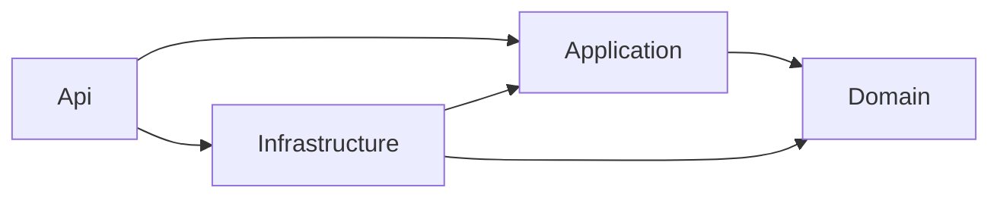

# Diseño táctico del backend

**Proyecto:** MaintenanceTracker · **Estado:** aprobado para implementación · **Fecha:** 2026-09-30

Este documento define *cómo* se construye el backend. El *qué* (lenguaje ubicuo, reglas, decisiones D1-D12 y contratos de la API) está en [`docs/domain/event-storming.md`](../domain/event-storming.md), que es la fuente de verdad para endpoints, tipos y códigos de error. Las decisiones de este documento se numeran T1, T2… para poder citarlas en el código y en el README.

## 1. Estado actual del repositorio

- `docker-compose.yml` con dos servicios: `db` (PostgreSQL 17 con healthcheck y volumen) y `api` (depende de `db` en estado `healthy`).
- `.env.example` con `POSTGRES_USER`, `POSTGRES_PASSWORD`, `POSTGRES_DB`, `POSTGRES_PORT` y `API_PORT`.
- `src/MaintenanceTracker.Api`: plantilla de Web API .NET 8 con controladores, sin HTTPS, con Swagger. Contiene aún el `WeatherForecast` de ejemplo, que se elimina al crear el primer endpoint real.
- `MaintenanceTracker.sln` en formato clásico (T22).
- `src/MaintenanceTracker.Api/Dockerfile`: multietapa con contexto de build en la raíz del repo. **Cada proyecto nuevo que referencie la API debe agregar su `COPY` del `.csproj` antes del `dotnet restore`**, igual que `Directory.Build.props` (T23).
- La API recibe la cadena de conexión por la variable `ConnectionStrings__Default`.

## 2. Estructura de la solución

| Proyecto | Contiene | Referencia a |
|---|---|---|
| `src/MaintenanceTracker.Domain` | Agregado, reglas de transición, entradas de historial, enums, excepciones de dominio. Sin paquetes NuGet. | — |
| `src/MaintenanceTracker.Application` | Casos de uso, modelos de lectura (respuestas), interfaces de persistencia y excepciones de aplicación. | `Domain` |
| `src/MaintenanceTracker.Infrastructure` | `DbContext`, configuraciones de EF Core, migraciones, seed, repositorio y servicio de consultas. | `Application`, `Domain` |
| `src/MaintenanceTracker.Api` | Controladores, cuerpos de petición, lectura de `X-User-Id`, manejo de errores, composición de dependencias. | `Application`, `Infrastructure` |
| `tests/MaintenanceTracker.Domain.Tests` | Pruebas unitarias de reglas, sin web ni base de datos. | `Domain` |
| `tests/MaintenanceTracker.Api.IntegrationTests` | Flujos de la API contra PostgreSQL real. | `Api` |

**T1.** Separación en proyectos por capas, no por carpetas. Que `Domain` no referencie nada lo garantiza el compilador: es imposible filtrar EF Core o ASP.NET al modelo. `Api` referencia a `Infrastructure` solo para registrar dependencias en `Program.cs`; los controladores dependen únicamente de `Application`.

**T2.** No se crean proyectos adicionales (contratos compartidos, comunes, etc.). Un solo bounded context con seis casos de uso no lo justifica.

**T22.** La solución usa el formato `.sln` y no `.slnx`. El evaluador puede tener solo el SDK 8, que no abre `.slnx` (el soporte llegó en el SDK 9.0.200). Se crea con `dotnet new sln --format sln` porque los SDK recientes generan `.slnx` por defecto.

**T23.** `Directory.Build.props` en la raíz define `TargetFramework`, `Nullable` e `ImplicitUsings` para todos los proyectos, así la configuración común existe en un solo lugar. El Dockerfile lo copia antes del `dotnet restore`; sin él, la imagen compilaría con otra configuración que la local.

## 3. Dominio

### 3.1 Agregado `MaintenanceRequest`

- Constructor privado. Se crea con un método de fábrica `Create(title, description, category, priority, requesterId, occurredAt)` que valida, asigna estado `Pending`, genera el `Id` (UUID, D9) y registra la entrada `Created` con `performedBy = requesterId`.
- Comandos: `AssignTo(assigneeId, performedBy, occurredAt)` y `ChangeStatus(targetStatus, performedBy, occurredAt)`. Cada uno valida su regla y, solo si pasa, cambia el estado interno y agrega su entrada de historial (D7). Un intento rechazado lanza excepción y no deja rastro.
- Propiedades de solo lectura; nada de setters públicos.
- Referencia a los usuarios **por identificador** (`RequesterId`, `AssigneeId`), no por navegación. La existencia del usuario en el catálogo la valida la capa de aplicación antes de invocar al agregado.

**T3.** La fecha llega al dominio como parámetro (`DateTimeOffset occurredAt`), no desde un reloj. El dominio queda determinista y las pruebas no dependen de la hora real. La aplicación obtiene la fecha de `TimeProvider` (inyectado, UTC).

### 3.2 Reglas de transición

**T4.** La tabla de transiciones y la guarda D6 viven en una clase estática y pura del dominio (por ejemplo `StatusTransitions`), con dos funciones:

- `IsAllowed(from, to)`: la tabla mínima del enunciado.
- `AllowedFrom(from, hasAssignee)`: destinos permitidos que además cumplen su guarda (D6: `InProgress` exige responsable).

El agregado las usa para validar y el servicio de consultas las usa para calcular `allowedTransitions` del detalle. Así la regla existe en un solo lugar y el detalle no necesita cargar el agregado. `canChangeAssignee` se calcula igual: estado no final.

Orden de validación en `ChangeStatus`: primero la tabla (`invalid_status_transition`), después la guarda (`assignee_required`).

Orden de validación en `AssignTo`: primero estado final (`request_closed`), después mismo responsable (`assignee_unchanged`).

### 3.3 Historial

- Clase base abstracta `ActivityEntry` (`Id`, `MaintenanceRequestId`, `OccurredAt`, `PerformedById`) y tres subclases inmutables: `CreatedActivity`, `StatusChangedActivity` (`FromStatus`, `ToStatus`) y `AssigneeChangedActivity` (`PreviousAssigneeId?`, `NewAssigneeId`).
- El agregado expone las entradas como colección de solo lectura respaldada por un campo privado.

**T5.** Para ejecutar comandos, el repositorio carga el agregado **sin** su historial: ninguna invariante depende de entradas pasadas. Las entradas nuevas que agrega el comando quedan rastreadas por EF Core y se insertan en el mismo `SaveChanges`. Esto se documenta en el código del repositorio porque la colección en memoria no representa el historial completo.

### 3.4 Validación y errores

**T6.** Las invariantes viven en el dominio: título y descripción se recortan y luego se valida su longitud (5-120 y 10-2.000), los enums deben ser valores definidos, y las reglas de transición y asignación. La API solo valida la forma de la petición (JSON válido, tipos, campos no contemplados por D3, rangos de paginación). No se usa FluentValidation: una sola fuente de verdad para cada regla.

**T7.** Los errores de negocio son excepciones con un `code` estable (sección 5.4 del Event Storming):

- Dominio: una excepción base (por ejemplo `DomainException`) con `Code`. Las de validación incluyen el campo afectado para poblar `errors` en la respuesta.
- Aplicación: `NotFound` (`maintenance_request_not_found`), usuario o responsable inexistente (`user_not_found`, `assignee_not_found`) y conflicto de concurrencia (`concurrency_conflict`).

Se eligieron excepciones sobre el patrón Result porque el mapeo a HTTP queda centralizado en un solo manejador (T13) y los casos de uso se leen de forma lineal. El patrón Result sería más explícito, pero más verboso para este tamaño.

## 4. Aplicación

**T8.** Una clase por caso de uso, invocada directamente desde el controlador. Sin MediatR: con seis casos de uso, un mediador agrega indirección sin beneficio, y la llamada directa es más fácil de seguir.

| Tipo | Casos de uso |
|---|---|
| Escritura | `CreateMaintenanceRequest`, `AssignMaintenanceRequest`, `ChangeMaintenanceRequestStatus` |
| Lectura | Listado paginado, detalle, historial paginado, resumen, catálogo de usuarios |

Flujo de un comando de escritura:

1. Verificar que el autor del cambio (`performedBy`) existe en el catálogo.
2. Cargar el agregado (404 si no existe) o crearlo.
3. Verificar existencia del responsable, si aplica.
4. Invocar el método del agregado con la fecha de `TimeProvider`.
5. Guardar en una sola llamada a `SaveChangesAsync`.
6. Devolver el detalle actualizado usando el servicio de consultas.

**T9.** CQRS ligero, sin librerías:

- **Escrituras** pasan por `IMaintenanceRequestRepository` (obtener por id, agregar) y una unidad de trabajo (`IUnitOfWork.SaveChangesAsync`). El repositorio existe solo para el agregado.
- **Lecturas** pasan por `IMaintenanceRequestQueries`, que proyecta directamente a los modelos de respuesta con `Select`, sin cargar agregados ni rastrear entidades. El historial es la excepción (T32).
- **Usuarios**: `IUserCatalog` para verificar existencia y listar.

Todas estas interfaces se definen en `Application` y se implementan en `Infrastructure` (inversión de dependencias).

**T10.** Los modelos de respuesta (`MaintenanceRequestDetail`, `MaintenanceRequestListItem`, `ActivityEntryDto` y derivados, `PagedResult<T>`, `RequestSummary`, `UserSummary`) se definen en `Application` como `record` y la API los serializa tal cual, porque coinciden 1:1 con el contrato. Los cuerpos de petición se definen en `Api` y el controlador los convierte en comandos. Nunca se exponen entidades del dominio ni de persistencia. El mapeo es manual, sin AutoMapper.

**T11.** Atomicidad (requisito no funcional del enunciado): el cambio del agregado y su entrada de historial se guardan en un único `SaveChanges`, que EF Core ejecuta en una sola transacción. Si falla el insert del historial, no se persiste el cambio. No se abren transacciones explícitas porque no hacen falta.

**T32.** El historial paginado no se resuelve con un solo `Select`. Primero se leen las entradas de la página sin rastreo, después los usuarios que esas entradas referencian (autor, responsable anterior y nuevo) en una segunda consulta, y los DTO se arman en memoria. Proyectar los tres subtipos con tres joins a `users` en una sola consulta resultaba mucho menos legible. El costo es una consulta más por página, con un catálogo de usuarios pequeño. Sigue sin cargar el agregado.

## 5. API

**T12.** Controladores delgados: leen la petición, obtienen el usuario actual, invocan el caso de uso y devuelven el resultado. Sin reglas de negocio ni acceso a datos.

- El usuario actual se obtiene de `X-User-Id` mediante una abstracción de la capa `Api` (por ejemplo `ICurrentUserProvider`). Si falta en una escritura: 400 `user_required`. Es el único punto que cambiaría con autenticación real (D1).
- Rutas según la sección 5.2 del Event Storming. `{id:guid}` como restricción de ruta.
- `POST /api/maintenance-requests` responde con `CreatedAtAction` (201 + `Location`).
- CORS: orígenes permitidos desde configuración (`Cors__AllowedOrigins`), para el frontend en `http://localhost:3000`.

Serialización JSON:

- `camelCase`; enums como texto con `JsonStringEnumConverter` sin permitir enteros.
- `UnmappedMemberHandling.Disallow` para rechazar campos no contemplados (D3).
- **No** usar `DefaultIgnoreCondition = WhenWritingNull`: `assignee: null` y `previousAssignee: null` son parte del contrato.
- `ActivityEntryDto` polimórfico con `[JsonPolymorphic(TypeDiscriminatorPropertyName = "type")]` y `[JsonDerivedType]` para `Created`, `StatusChanged` y `AssigneeChanged`.

**T25.** Las propiedades de los cuerpos de petición son anulables y llevan `[Required]`. Con un tipo no anulable, un campo ausente tomaría su valor por defecto sin avisar (por ejemplo, un enum ausente se leería como `Infrastructure`, el valor 0). Así, un campo ausente o `null` devuelve 400 `validation_failed`.

**T26.** Los parámetros de query de tipo enum (`status`, `priority`, `category`) solo aceptan el nombre del valor. El model binding de MVC acepta números (`?status=1`) y `allowIntegerValues: false` solo protege el JSON, así que un valor numérico se rechaza explícitamente con 400 `validation_failed`. Así se mantiene la convención de enums como texto (sección 5.1 del Event Storming).

**T27.** Un `X-User-Id` presente pero sin formato UUID devuelve 400 `validation_failed` (tabla 5.4 del Event Storming). Es un dato mal formado, no un usuario inexistente; `user_not_found` queda para UUIDs válidos que no están en el catálogo.

**T30.** Las fechas se escriben en UTC con sufijo `Z` (`2026-09-30T13:05:12.534581Z`), como en los ejemplos del contrato, mediante un convertidor JSON propio para `DateTimeOffset` en la API. El convertidor por defecto escribe `+00:00`, que también es ISO 8601 pero no coincide con los ejemplos.

**T31.** Los enums de la query (T26) aceptan el nombre sin distinguir mayúsculas (`status=pending`, `sortDirection=ASC`), igual que los del cuerpo JSON, porque `JsonStringEnumConverter` tampoco distingue al leer. Números y combinaciones (`High,Low`) se rechazan. Lo resuelve un model binder propio (`EnumNameModelBinder`) que solo compara contra los nombres del enum.

**T33.** `ActivityEntryDto` declara su discriminador con `[JsonPolymorphic]` y `[JsonDerivedType]` dentro de `Application`. Esos atributos vienen con .NET (`System.Text.Json`) y no con un paquete NuGet, así que la regla de T1 se mantiene. La alternativa, configurar el polimorfismo en la API con un `TypeInfoResolver`, separa mejor las capas pero es menos directa de leer. El discriminador `type` se escribe como primera propiedad de cada entrada; el orden no altera el contrato.

**T13.** Manejo centralizado de errores con `IExceptionHandler` y `AddProblemDetails`:

- Excepciones de dominio y aplicación → ProblemDetails con el `code` y el HTTP de la sección 5.4.
- Errores de binding o JSON inválido → 400 `validation_failed`, configurando `InvalidModelStateResponseFactory`.
- Cualquier otra excepción → 500 `internal_error` con mensaje genérico y `traceId`, sin detalles internos. Se registra en el log.

## 6. Persistencia

**T14.** Npgsql + EF Core 8 con `EFCore.NamingConventions` para nombres `snake_case` en tablas y columnas.

### 6.1 Tablas

| Tabla | Columnas relevantes |
|---|---|
| `users` | `id` (PK), `name` |
| `maintenance_requests` | `id` (PK), `title` varchar(120), `description` varchar(2000), `category`, `priority`, `status`, `requester_id` (FK), `assignee_id` (FK, nulo), `created_at` timestamptz |
| `activity_entries` | `id` (PK), `maintenance_request_id` (FK), `type`, `occurred_at` timestamptz, `performed_by_id` (FK), `from_status`, `to_status`, `previous_assignee_id` (FK), `new_assignee_id` (FK) |

Todas las FK con `ON DELETE RESTRICT`: el historial no se borra en cascada.

**T24.** `User` es una clase de persistencia en `Infrastructure`, no una entidad de dominio. El dominio no tiene reglas sobre usuarios: el agregado solo guarda sus identificadores (sección 3.1) y la existencia se verifica mediante `IUserCatalog`. La clase existe para que EF Core cree la tabla, las FKs y el seed.

**T15.** Enums guardados como texto (`HasConversion<string>()`) con restricción `CHECK` que limita los valores válidos. Se descartan los enums nativos de PostgreSQL porque agregar o renombrar valores exige migraciones más delicadas, y el texto es legible al consultar la base directamente.

**T16.** Historial con herencia TPH: una sola tabla con discriminador `type`. Las columnas de cada subtipo son nulables, y restricciones `CHECK` garantizan que cada tipo tenga las suyas (por ejemplo, `StatusChanged` exige `from_status` y `to_status`). Se prefirió sobre TPT porque el historial se consulta siempre completo y ordenado, y una sola tabla evita joins; y sobre JSON porque mantiene FKs reales hacia `users`.

Restricciones adicionales en `maintenance_requests` como defensa en profundidad: longitud del título y la descripción recortados.

### 6.2 Índices

| Índice | Justificación |
|---|---|
| `maintenance_requests (created_at, id)` | Ordenamiento del listado con desempate por id; sirve en ambas direcciones. |
| `maintenance_requests (status)`, `(priority)`, `(category)` | Filtros del listado y agrupación del resumen. |
| `maintenance_requests` GIN `title gin_trgm_ops` | Búsqueda parcial sin distinguir mayúsculas (`ILIKE '%texto%'`), que un B-tree no puede atender. Requiere la extensión `pg_trgm`, habilitada desde la migración con `HasPostgresExtension`. |
| `activity_entries (maintenance_request_id, occurred_at, id)` | Historial paginado de una solicitud en orden cronológico. |
| FKs de `assignee_id`, `requester_id`, `performed_by_id` | Joins hacia `users` en listado, detalle e historial. |

La búsqueda escapa `%`, `_` y `\` del texto del usuario antes de construir el patrón.

**T17.** Concurrencia optimista con la columna de sistema `xmin` de PostgreSQL como token (D8), mapeada como propiedad sombra, para que el dominio no conozca el mecanismo. `DbUpdateConcurrencyException` se traduce en `Infrastructure` a la excepción de aplicación de `concurrency_conflict`.

**T18.** Usuarios de prueba sembrados con `HasData` en la migración, con IDs fijos (los mismos del Event Storming y del prompt de UI):

| Id | Nombre |
|---|---|
| `0b6a2f4e-1c3d-4e5f-8a9b-1d2e3f4a5b01` | Ana Restrepo |
| `0b6a2f4e-1c3d-4e5f-8a9b-1d2e3f4a5b02` | Laura Gómez |
| `0b6a2f4e-1c3d-4e5f-8a9b-1d2e3f4a5b03` | Carlos Mejía |
| `0b6a2f4e-1c3d-4e5f-8a9b-1d2e3f4a5b04` | Andrés Ríos |
| `0b6a2f4e-1c3d-4e5f-8a9b-1d2e3f4a5b05` | Sofía Vélez |

**T19.** Las migraciones se aplican al arrancar la API (`Database.MigrateAsync`) cuando `Database__ApplyMigrationsOnStartup=true`, activado en Docker Compose. Cumple "clonar y ejecutar sin pasos manuales". En un entorno real se aplicarían desde el pipeline de despliegue; queda como limitación documentada.

**T20.** El resumen se calcula con una sola consulta agregada (`GROUP BY status`) y se completa con ceros para los estados sin solicitudes. No hay proyección materializada: con este volumen el conteo es barato y siempre refleja los datos persistidos.

## 7. Pruebas

**T21.** xUnit como framework. Aserciones con **Shouldly**. Se descarta FluentAssertions porque desde la versión 8 tiene licencia comercial y el enunciado exige licencias compatibles.

`Domain.Tests` (sin web ni base de datos):

- Creación válida: estado `Pending`, entrada `Created` con el solicitante como autor.
- Rechazo de datos inválidos, con casos límite (4/5 y 120/121 caracteres en título; 9/10 y 2.000/2.001 en descripción; espacios recortados).
- Todas las combinaciones de la tabla de transiciones (`[Theory]`): las permitidas pasan y las demás lanzan `invalid_status_transition`.
- Guarda D6: `Pending → InProgress` sin responsable lanza `assignee_required`.
- Reglas de asignación (D5): `request_closed` y `assignee_unchanged`.
- Historial: cada cambio exitoso agrega exactamente una entrada con datos correctos; cada intento rechazado no agrega ninguna.
- `AllowedFrom` coincide con lo que el agregado acepta.

`Api.IntegrationTests` con `WebApplicationFactory` y Testcontainers (`Testcontainers.PostgreSql`), aplicando las migraciones reales:

- Flujo principal: crear → asignar → iniciar → consultar detalle e historial, verificando persistencia y orden.
- Transición inválida devuelve 409 con `code` correcto y no agrega historial.
- Petición inválida devuelve 400 `validation_failed`.
- Conflicto de concurrencia (T28).

**T28.** La prueba de concurrencia es determinista, sin peticiones en paralelo. Dos contextos cargan la misma solicitud, la modifican y guardan uno tras otro; el segundo debe producir `concurrency_conflict`. Con peticiones simultáneas, el resultado dependería del orden de ejecución y la prueba podría fallar de forma intermitente.

Requisito para ejecutar las pruebas de integración: Docker corriendo.

## 8. Paquetes permitidos

| Proyecto | Paquetes |
|---|---|
| `Domain` | Ninguno |
| `Application` | Ninguno |
| `Infrastructure` | `Npgsql.EntityFrameworkCore.PostgreSQL` 8.x, `EFCore.NamingConventions` 8.x, `Microsoft.EntityFrameworkCore.Design` 8.x |
| `Api` | `Swashbuckle.AspNetCore` (de la plantilla), `Microsoft.EntityFrameworkCore.Design` 8.x (para las herramientas de migración) |
| Pruebas | `xunit`, `xunit.runner.visualstudio`, `Microsoft.NET.Test.Sdk`, `Shouldly`, `Microsoft.AspNetCore.Mvc.Testing` 8.x, `Testcontainers.PostgreSql` |

No se usan MediatR, AutoMapper, FluentValidation ni FluentAssertions (T8, T10, T6, T21).

**T29.** `dotnet-ef` 8.x se fija en un manifiesto local (`.config/dotnet-tools.json`) para que la herramienta coincida con EF Core 8, sin depender de la versión global instalada en cada máquina. `dotnet tool restore` solo hace falta para crear migraciones: ejecutar la aplicación o las pruebas no lo requiere, porque las migraciones se aplican al arrancar (T19). Se documenta en el README.

**T34.** `Microsoft.EntityFrameworkCore.Design` y `dotnet-ef` se fijan en la misma versión de EF Core que trae `Npgsql.EntityFrameworkCore.PostgreSQL` (8.0.11). `Design` se referencia con `PrivateAssets=all` y no llega a los proyectos que dependen de Infrastructure. Con una versión mayor, Infrastructure compilaba contra un EF Core más nuevo que el que reciben la API y las pruebas de integración, y la compilación fallaba (CS1705). Al subir de versión, los tres se actualizan juntos.

## 9. Fuera de alcance

Autenticación y roles, desasignar responsable, edición de título o descripción, eliminación de solicitudes, auditoría de lecturas, notificaciones y despliegue en la nube.
