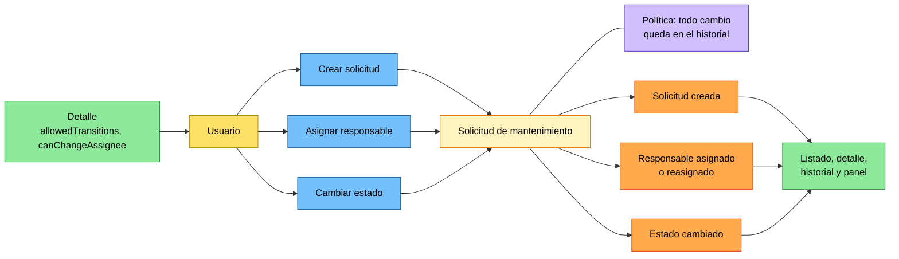
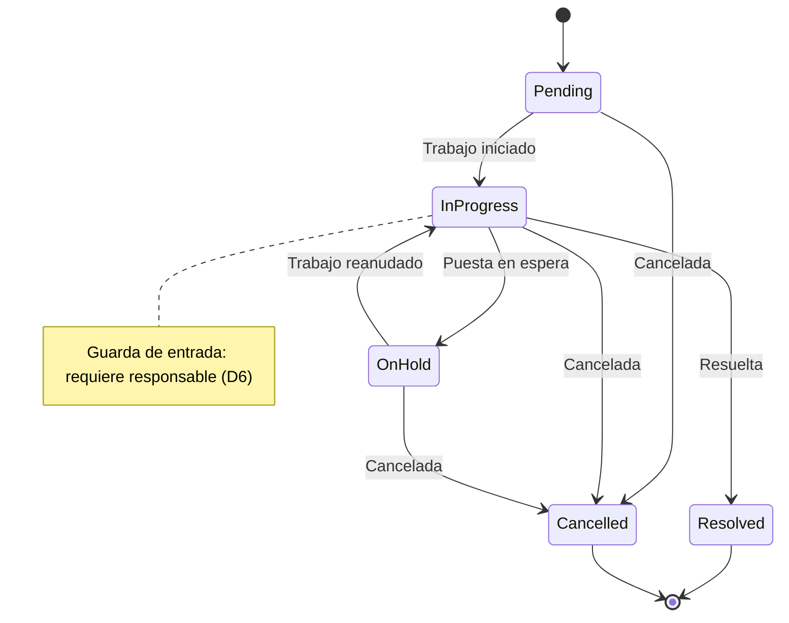

# Descubrimiento del dominio: Event Storming y contratos de la API

**Proyecto:** Gestión de solicitudes de mantenimiento · **Estado:** borrador para validación · **Fecha:** 2026-09-30

## 1. Propósito

Event Storming ligero para fijar el lenguaje del dominio, justificar las decisiones que el enunciado deja abiertas y derivar los contratos entre backend y frontend. Las decisiones de implementación quedan para el plan táctico (sección 6).

El dominio es un único bounded context, **Gestión de Solicitudes de Mantenimiento**. No hay términos que cambien de significado entre áreas ni equipos distintos, así que dividirlo solo añadiría integración sin resolver nada.

## 2. Lenguaje ubicuo

| Término | En código | Definición |
|---|---|---|
| Solicitud de mantenimiento | `MaintenanceRequest` | Petición de intervención sobre una instalación o equipo. Raíz del agregado. |
| Usuario | `User` | Persona del catálogo de prueba. Según la operación, cumple uno de los roles siguientes. |
| Solicitante | `Requester` | Usuario que registra la solicitud. |
| Responsable | `Assignee` | Usuario encargado de atenderla. Puede no existir todavía. |
| Autor del cambio | `performedBy` | Usuario que ejecutó la operación registrada en el historial. El enunciado lo llama "actor". |
| Estado | `RequestStatus` | `Pending`, `InProgress`, `OnHold`, `Resolved`, `Cancelled`. `Resolved` y `Cancelled` son finales. |
| Entrada de historial | `ActivityEntry` | Registro inmutable de un hecho ocurrido sobre la solicitud. |
| Categoría | `Category` | `Infrastructure`, `Equipment`, `Software`, `Other`. |
| Prioridad | `Priority` | `Low`, `Medium`, `High`, `Critical`. |

## 3. Event Storming

### 3.1 Eventos

Los eventos se agrupan en tres familias. La asignación es independiente del ciclo de vida: puede ocurrir en cualquier estado no final. Su único punto de contacto con los estados es la guarda de la decisión D6.

| Familia | Eventos de negocio | Entrada de historial |
|---|---|---|
| Creación | Solicitud creada | `Created` |
| Asignación | Responsable asignado, responsable reasignado | `AssigneeChanged` |
| Ciclo de vida | Trabajo iniciado, solicitud puesta en espera, trabajo reanudado, solicitud resuelta, solicitud cancelada | `StatusChanged` |

El frontend puede mostrar el nombre de negocio a partir de `fromStatus` y `toStatus`. Por ejemplo, `OnHold → InProgress` se muestra como "Trabajo reanudado".

### 3.2 Diagrama de diseño

Colores: amarillo, quien actúa; azul, comando; amarillo pálido, agregado; naranja, evento; lila, política; verde, read model.



La política del historial está unida al agregado y no detrás de los eventos: no es una reacción posterior, sino parte de la misma operación (D7).

### 3.3 Máquina de estados

Desde cualquier estado no final se puede cancelar. Los estados finales no admiten transiciones, y "cambiar" al mismo estado se rechaza porque no está en la tabla.



`allowedTransitions` contiene los destinos permitidos que además cumplen su guarda. El frontend muestra solo esas acciones y no replica la tabla. El backend vuelve a validar en cada comando.

## 4. Decisiones

| ID | Decisión | Por qué |
|---|---|---|
| D1 | Sin autenticación, el usuario actual llega en el header `X-User-Id` y debe existir en el catálogo. No se aplican roles. | Es la simplificación que permite el enunciado. Queda aislada en un solo punto: con autenticación real solo cambia la fuente (claims), no el dominio ni los contratos. |
| D2 | El solicitante es el usuario que crea la solicitud. | Evita un campo redundante y el caso "registrar a nombre de otro", que exigiría reglas de autorización inexistentes. |
| D3 | El cliente no envía estado, solicitante ni fecha. Los cuerpos rechazan campos no contemplados con 400. | Hace visible la regla de RF-01 en vez de ignorar el campo en silencio. |
| D4 | Un solo comando `ChangeStatus(targetStatus)` gobernado por la tabla de transiciones. | Las transiciones no llevan datos ni comportamiento propios. Si alguna los necesitara (por ejemplo, un motivo de cancelación), se promovería a comando específico. |
| D5 | Solo se asigna en estados no finales y a un responsable distinto del actual. No se puede quitar el responsable. | Esos cambios no tienen significado de negocio y ensuciarían el historial. Quitar el responsable queda fuera del alcance. |
| D6 | Para pasar a `InProgress` se requiere responsable. | "En progreso" implica que alguien trabaja en la solicitud. Complementa la tabla mínima del enunciado sin contradecirla. |
| D7 | El historial es parte del agregado. Cada operación valida la regla y agrega su entrada (incluida `Created` al crear) en una sola transacción. Los intentos rechazados no se registran. | "No hay cambio sin historial" es un invariante del agregado, garantizado por construcción. Se descartó escribir el historial desde manejadores de eventos: suma piezas sin consumidores externos. |
| D8 | Concurrencia optimista: si otro cambio se guardó primero, 409 `concurrency_conflict`. | La validez de una transición depende del estado leído. Sin control, "resolver" y "cancelar" simultáneos podrían guardarse ambos. |
| D9 | El identificador es un UUID generado por el dominio al crear la solicitud. | El agregado tiene identidad desde que nace y se prueba sin base de datos. Un folio legible queda como mejora. |
| D10 | 400 para datos inválidos; 409 para operaciones que chocan con el estado actual. Todo error lleva un `code` estable. | Le indica al cliente si debe corregir la petición o refrescar. El frontend decide por `code`, no por el mensaje. |
| D11 | Asignar y cambiar estado son `POST` sobre `/assignments` y `/status-changes`, y responden 200 con la solicitud actualizada. | Cada llamada registra un hecho nuevo, así que no es idempotente como exigiría `PUT`. Devolver el detalle evita una segunda petición. |
| D12 | El historial es un recurso propio y paginado: `GET /api/maintenance-requests/{id}/activity`. El detalle no lo incluye. | El detalle describe el estado actual y tiene tamaño acotado; el historial crece con cada operación. Separarlo evita que el peso del detalle dependa de la antigüedad de la solicitud, permite paginarlo y cargarlo solo cuando la interfaz lo muestra. |

## 5. Contratos de la API

### 5.1 Convenciones

- Prefijo `/api`. JSON en `camelCase`. Enums como texto en inglés; las etiquetas en español las pone el frontend.
- Fechas generadas por el servidor, en UTC e ISO 8601. Identificadores como UUID en texto.
- Las escrituras exigen `X-User-Id` (D1).
- Título y descripción se recortan antes de validar su longitud.
- Errores en ProblemDetails (RFC 9457) con `code`, sin detalles internos.

### 5.2 Endpoints

| Endpoint | Origen | Respuesta |
|---|---|---|
| `GET /api/users` | Read model: usuarios | 200 `UserSummary[]` |
| `POST /api/maintenance-requests` | Comando: crear | 201 `MaintenanceRequestDetail` con `Location` |
| `GET /api/maintenance-requests` | Read model: listado | 200 `PagedResult<MaintenanceRequestListItem>` |
| `GET /api/maintenance-requests/{id}` | Read model: detalle | 200 `MaintenanceRequestDetail` |
| `POST /api/maintenance-requests/{id}/assignments` | Comando: asignar | 200 `MaintenanceRequestDetail` |
| `POST /api/maintenance-requests/{id}/status-changes` | Comando: cambiar estado | 200 `MaintenanceRequestDetail` |
| `GET /api/maintenance-requests/{id}/activity` | Read model: historial | 200 `PagedResult<ActivityEntry>` |
| `GET /api/maintenance-requests/summary` | Read model: panel | 200 `RequestSummary`, siempre con los cinco estados |

La ruta `{id}` se restringe a UUID para que `summary` no se tome como identificador.

Parámetros del listado:

| Parámetro | Valores | Por defecto |
|---|---|---|
| `page` | entero ≥ 1; una página fuera de rango devuelve `items` vacío | 1 |
| `pageSize` | entero entre 1 y 50 | 10 |
| `status`, `priority`, `category` | valores del enum; se combinan entre sí | sin filtro |
| `search` | hasta 120 caracteres; coincidencia parcial en el título, sin distinguir mayúsculas | sin filtro |
| `sortDirection` | `asc` o `desc` por fecha de creación; desempate por id | `desc` |

El historial acepta `page` y `pageSize` con los mismos límites, en orden cronológico ascendente y sin filtros.

### 5.3 Tipos TypeScript

```ts
export type RequestStatus = "Pending" | "InProgress" | "OnHold" | "Resolved" | "Cancelled";
export type Category = "Infrastructure" | "Equipment" | "Software" | "Other";
export type Priority = "Low" | "Medium" | "High" | "Critical";

export interface UserSummary { id: string; name: string; }

export interface MaintenanceRequestListItem {
  id: string;
  title: string;
  category: Category;
  priority: Priority;
  status: RequestStatus;
  assignee: UserSummary | null;
  createdAt: string;
}

export interface MaintenanceRequestDetail extends MaintenanceRequestListItem {
  description: string;
  requester: UserSummary;
  allowedTransitions: RequestStatus[];
  canChangeAssignee: boolean;
}

// Historial: GET /api/maintenance-requests/{id}/activity → PagedResult<ActivityEntry>

interface ActivityBase { id: string; occurredAt: string; performedBy: UserSummary; }

export type ActivityEntry =
  | (ActivityBase & { type: "Created" })
  | (ActivityBase & { type: "StatusChanged"; fromStatus: RequestStatus; toStatus: RequestStatus })
  | (ActivityBase & { type: "AssigneeChanged"; previousAssignee: UserSummary | null; newAssignee: UserSummary });

export interface PagedResult<T> {
  items: T[];
  page: number;
  pageSize: number;
  totalCount: number;
  totalPages: number;
}

export interface RequestSummary { total: number; byStatus: Record<RequestStatus, number>; }

export interface CreateMaintenanceRequestBody {
  title: string;
  description: string;
  category: Category;
  priority: Priority;
}
export interface AssignBody { assigneeId: string; }
export interface ChangeStatusBody { targetStatus: RequestStatus; }

export interface MaintenanceRequestQuery {
  page?: number;
  pageSize?: number;
  status?: RequestStatus;
  priority?: Priority;
  category?: Category;
  search?: string;
  sortDirection?: "asc" | "desc";
}

export interface ApiProblem {
  title: string;
  status: number;
  code: string;                       // ver sección 5.4
  detail?: string;
  errors?: Record<string, string[]>;  // solo en validation_failed
  traceId?: string;
}
```

### 5.4 Errores

| `code` | HTTP | Cuándo |
|---|---|---|
| `validation_failed` | 400 | Datos o parámetros inválidos, campos no contemplados, o `X-User-Id` sin formato UUID. |
| `user_required` | 400 | Falta `X-User-Id` en una escritura. |
| `user_not_found` | 400 | `X-User-Id` no existe en el catálogo. |
| `assignee_not_found` | 400 | `assigneeId` no existe en el catálogo. |
| `maintenance_request_not_found` | 404 | La solicitud no existe. |
| `invalid_status_transition` | 409 | Transición fuera de la tabla. |
| `assignee_required` | 409 | Paso a `InProgress` sin responsable (D6). |
| `request_closed` | 409 | Asignación sobre una solicitud en estado final (D5). |
| `assignee_unchanged` | 409 | Reasignación al mismo responsable (D5). |
| `concurrency_conflict` | 409 | Otro cambio se guardó primero; recargar (D8). |
| `internal_error` | 500 | Error inesperado; mensaje genérico con `traceId`. |

### 5.5 Ejemplos

**Detalle** (`GET /api/maintenance-requests/{id}`):

```json
{
  "id": "3f2b6c1e-8d4a-4f5b-9c7e-2a1d0e9b4c11",
  "title": "Aire acondicionado sin enfriar en sala de servidores",
  "description": "El equipo de la sala 2 marca 27 °C desde esta mañana y no responde al control.",
  "category": "Equipment",
  "priority": "Critical",
  "status": "InProgress",
  "assignee": { "id": "0b6a2f4e-1c3d-4e5f-8a9b-1d2e3f4a5b03", "name": "Carlos Mejía" },
  "requester": { "id": "0b6a2f4e-1c3d-4e5f-8a9b-1d2e3f4a5b01", "name": "Ana Restrepo" },
  "createdAt": "2026-09-30T13:05:12Z",
  "allowedTransitions": ["OnHold", "Resolved", "Cancelled"],
  "canChangeAssignee": true
}
```

**Historial** (`GET /api/maintenance-requests/{id}/activity?page=1&pageSize=10`):

```json
{
  "items": [
    {
      "id": "7c1e0a52-3b9d-4c2f-a8e1-5d6f7a8b9c01", "type": "Created",
      "occurredAt": "2026-09-30T13:05:12Z",
      "performedBy": { "id": "0b6a2f4e-1c3d-4e5f-8a9b-1d2e3f4a5b01", "name": "Ana Restrepo" }
    },
    {
      "id": "7c1e0a52-3b9d-4c2f-a8e1-5d6f7a8b9c02", "type": "AssigneeChanged",
      "occurredAt": "2026-09-30T13:20:40Z",
      "performedBy": { "id": "0b6a2f4e-1c3d-4e5f-8a9b-1d2e3f4a5b02", "name": "Laura Gómez" },
      "previousAssignee": null,
      "newAssignee": { "id": "0b6a2f4e-1c3d-4e5f-8a9b-1d2e3f4a5b03", "name": "Carlos Mejía" }
    },
    {
      "id": "7c1e0a52-3b9d-4c2f-a8e1-5d6f7a8b9c03", "type": "StatusChanged",
      "occurredAt": "2026-09-30T13:32:02Z",
      "performedBy": { "id": "0b6a2f4e-1c3d-4e5f-8a9b-1d2e3f4a5b03", "name": "Carlos Mejía" },
      "fromStatus": "Pending", "toStatus": "InProgress"
    }
  ],
  "page": 1,
  "pageSize": 10,
  "totalCount": 3,
  "totalPages": 1
}
```

## 6. Pendientes para el plan táctico

- Estructura de la solución y validaciones: cuáles viven en la API y cuáles en el dominio.
- Representación del historial y de los enums en PostgreSQL, restricciones e índices (incluida la búsqueda por título).
- Token de concurrencia (`xmin`), seed de usuarios y migraciones automáticas.
- Panel resuelto con una consulta agregada, sin proyección materializada.
- Serialización polimórfica de `ActivityEntry` sin omitir `null` de forma global, porque forma parte del contrato.
